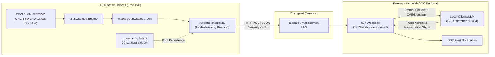

# AI-Assisted SOC Alert Triage Pipeline


An automated Security Operations Center (SOC) alert ingestion and LLM-assisted triage pipeline. This project streams real-time **Suricata IDS** `eve.json` alerts from an **OPNsense (FreeBSD)** firewall via a lightweight zero-dependency Python daemon over **Tailscale / LAN** to an **n8n** orchestration workflow backed by a GPU-accelerated local **Ollama LLM** inference server.

---

## System Architecture



### Technology Stack
* **Firewall & IDS:** OPNsense (FreeBSD), Suricata IDS (`eve.json` telemetry)
* **Log Shipper Daemon:** Python 3 standard library (`urllib.request`, `os.stat` inode rotation tracking)
* **Service Persistence:** FreeBSD `rc.syshook.d` boot lifecycle hook
* **Transport Layer:** Tailscale WireGuard Mesh / Isolated VLAN HTTP POST
* **SOAR & AI Triage:** n8n workflow automation + Local Ollama LLM API

---

## Repository Structure

```text
soc-ai-alert-triage/
├── src/
│   └── suricata_shipper.py       # Inode-aware EVE JSON log tailing & webhook shipper daemon
├── freebsd/
│   └── 99-suricata-shipper       # OPNsense /usr/local/etc/rc.syshook.d/start/ boot script
├── .env.example                  # Environment configuration template
└── README.md                     # Architecture, deployment & engineering troubleshooting log
```

---

## Deployment Guide (OPNsense / FreeBSD)

### 1. Disable NIC Hardware Offloading in OPNsense
Before enabling Suricata inline/promiscuous inspection, navigate to **Interfaces -> Settings** in the OPNsense WebGUI and check:
* **Disable hardware checksum offload (CRC)**
* **Disable hardware TCP segmentation offload (TSO)**
* **Disable hardware large receive offload (LRO)**

### 2. Install the Shipper Daemon
Copy [`src/suricata_shipper.py`](./src/suricata_shipper.py) to `/root/scripts/suricata_shipper.py` on the OPNsense host and make it executable:

```sh
mkdir -p /root/scripts
cp src/suricata_shipper.py /root/scripts/suricata_shipper.py
chmod +x /root/scripts/suricata_shipper.py
```

### 3. Register FreeBSD Boot Persistence Hook
Install [`freebsd/99-suricata-shipper`](./freebsd/99-suricata-shipper) into OPNsense's startup hook directory so the daemon starts automatically on firewall boot:

```sh
cp freebsd/99-suricata-shipper /usr/local/etc/rc.syshook.d/start/99-suricata-shipper
chmod +x /usr/local/etc/rc.syshook.d/start/99-suricata-shipper
/usr/local/etc/rc.syshook.d/start/99-suricata-shipper
```

---

## Engineering & Troubleshooting Log

### 1. NIC Hardware Offloading Breaking Deep Packet Inspection
* **Symptom:** Suricata initially missed malformed packet streams and caused throughput drops when inspecting traffic across interfaces.
* **Root Cause:** Network interface card (NIC) hardware offloading features reassemble or checksum packets in silicon before the kernel passes frames to the Suricata packet capture ring buffer.
* **Resolution:** Disabled **Hardware CRC**, **Hardware TSO (TCP Segmentation Offload)**, and **Hardware LRO (Large Receive Offload)** under `Interfaces -> Settings` in OPNsense, restoring accurate stream reassembly and signature matching.

### 2. Daemon Persistence & Log Rotation on FreeBSD
* **Symptom:** Running the Python shipper interactively terminated whenever the administrative SSH session disconnected. Additionally, nightly Suricata log rotation (`newsyslog`) replaced `/var/log/suricata/eve.json`, leaving the Python process reading a stale, unlinked file descriptor.
* **Resolution:**
  1. Implemented **inode tracking** (`os.stat(filepath).st_ino != inode`) inside `tail_eve_log()` so the generator detects file replacement immediately and reopens the active `eve.json` file descriptor without dropping alerts.
  2. Registered an executable startup hook inside `/usr/local/etc/rc.syshook.d/start/99-suricata-shipper` using `nohup` and standard output redirection to `/var/log/suricata_shipper.log`.

### 3. Webhook Routing Across Isolated Subnets
* **Symptom:** Outbound HTTP POST requests from the OPNsense BSD host to the containerized n8n webhook endpoint timed out across isolated VLAN boundaries.
* **Resolution:** Verified packet traversal between the OPNsense host and the containerized n8n endpoint over Tailscale/LAN using `curl -X POST` probes and configured local firewall floating rules to permit outbound telemetry traffic on port `5678`.
